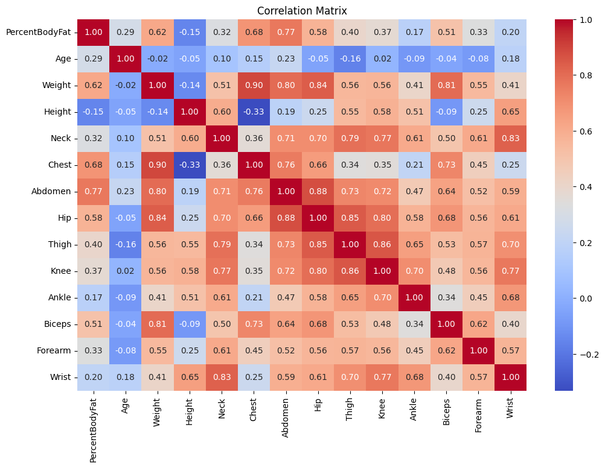
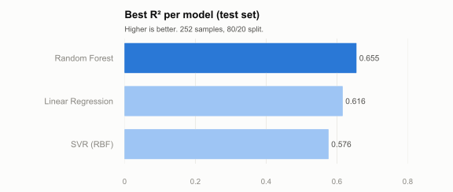
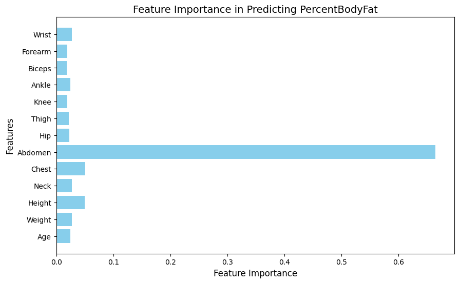

# 📏 Estimating Body Fat with Regression

**Can simple body measurements replace expensive tests for body-fat percentage?**
Exploratory analysis → feature selection → three regression models compared.

`252 people` · `13 measurements` · `3 models` · `best R² 0.655`

> This repository is a **project showcase**. Source code and the full report are private.
> Contact: albinajeti20@gmail.com

## Overview

Measuring body fat accurately usually needs specialised equipment such as hydrostatic weighing.
This project tests how well it can be predicted from age, weight, height and ten body circumferences (neck, chest, abdomen, hip, and so on).

| Stage | What I did |
|---|---|
| **1. Data preparation** | Cleaned the dataset (252 samples), removed an empty column and checked the distributions. |
| **2. Exploration** | Studied the correlations between the measurements and body fat. |
| **3. Modelling** | Trained Multiple Linear Regression, SVR (RBF kernel) and Random Forest on three feature sets: all features, the top 3 correlated features, and abdomen only. |
| **4. Evaluation** | Compared the models with R², MSE and MAE on a 20% test set. |

## Exploration

**Abdomen, chest and weight** are the measurements most correlated with body fat. Many measurements are also strongly correlated with each other (e.g. weight and chest), so several features carry overlapping information.

## Results

| Model | All features | Top 3 features | Abdomen only |
|---|---|---|---|
| **Random Forest** | **0.655** | 0.626 | 0.313 |
| Linear Regression | 0.616 | 0.560 | 0.493 |
| SVR (tuned) | 0.552 | 0.576 | 0.523 |

R² on the test set. Higher is better.

- **Random Forest with all features** explains about **66% of the variation** in body fat (MSE 16.0).
- **Abdomen** is by far the most important single measurement:

- Abdomen alone is not enough, though. Every model does better when it also uses the other measurements.

## Next steps
- Cross-validation and hyperparameter search (e.g. `max_depth` for Random Forest)
- Ridge / Lasso regression to handle the overlapping features

© 2025 Albin Ajeti. All rights reserved. See [LICENSE](LICENSE).
